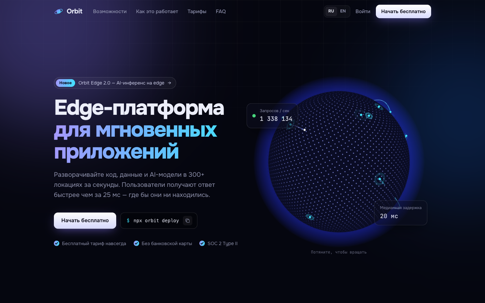
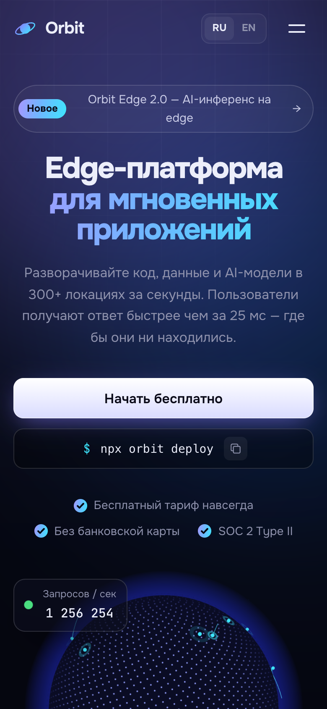

<div align="center">

# Orbit

**Лендинг SaaS edge-платформы с 3D-глобусом** · RU / EN

<a href="https://cdduke.github.io/orbit-saas/"></a>

     

&nbsp;

*🇬🇧 SaaS landing page with a custom-shader Three.js globe, live bento grid, code panel with syntax highlighting and pricing.*

</div>

---

Концепт продуктового сайта для вымышленной облачной edge-платформы: тёмный интерфейс в духе Vercel/Linear,
интерактивный 3D-глобус и «живые» данные. **Двуязычный: русский (по умолчанию) и английский.**

**Стек:** Vite · **TypeScript** (strict) · **Three.js** (свои GLSL-шейдеры) · GSAP ScrollTrigger · CSS без фреймворков

## Что внутри

- **3D-глобус на Three.js**: 5 200 точек по сфере Фибоначчи (шейдер с затуханием на обратной стороне),
  атмосфера на fresnel-шейдере, маркеры городов с пульсацией, дуги запросов между городами с бегущим импульсом;
  вращение мышью/пальцем с инерцией; рендер останавливается, когда глобус вне экрана или вкладка скрыта
- Three.js грузится **лениво** (`import()`), поэтому страница отображается сразу (основной бандл ~52 КБ gzip)
- **Bento-сетка** с подсветкой за курсором: живой график задержки (SVG), терминал с печатью команд,
  анимированные столбцы аналитики, счётчик отражённых атак, бегущие строки технологий
- **«Как это работает»**: шаги с автопереключением и прогресс-баром + код-панель со своей подсветкой синтаксиса
- **Тарифы** с переключателем «месяц / год» и анимацией цен, **FAQ-аккордеон** на CSS grid
- Копирование команды в буфер обмена, живые метрики, мобильное меню
- Свой типизированный модуль локализации (i18n): тексты, мета-теги, код-примеры и терминал на двух языках

## Адаптивность и доступность

- Проверено на 390px, 820px и 1440px (скриншоты через headless Chrome)
- `prefers-reduced-motion`: глобус и анимации замирают
- Если WebGL недоступен, страница продолжает работать без глобуса

## Запуск

```bash
npm install
npm run dev      # http://localhost:5175
npm run build    # проверка типов (tsc) + сборка
```

---

*Concept product built as a portfolio piece. Bilingual: Russian / English.*


**Демо:** https://cdduke.github.io/orbit-saas/
